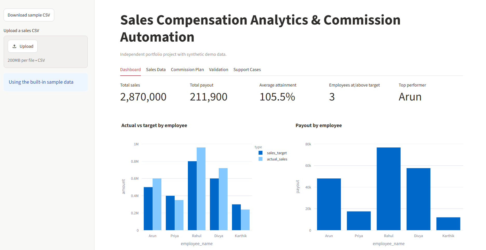
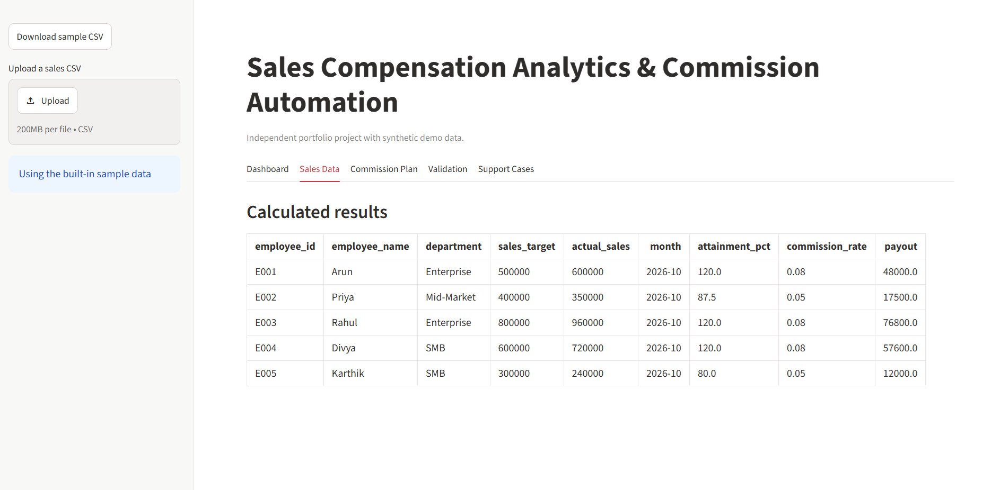
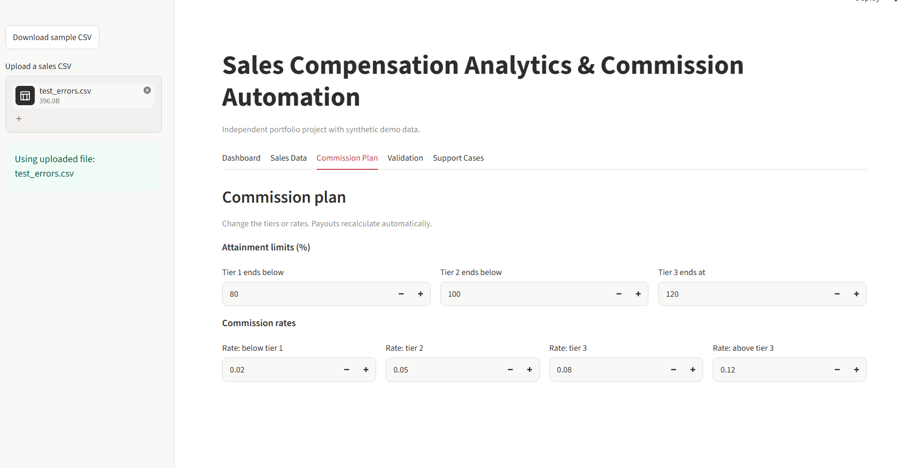
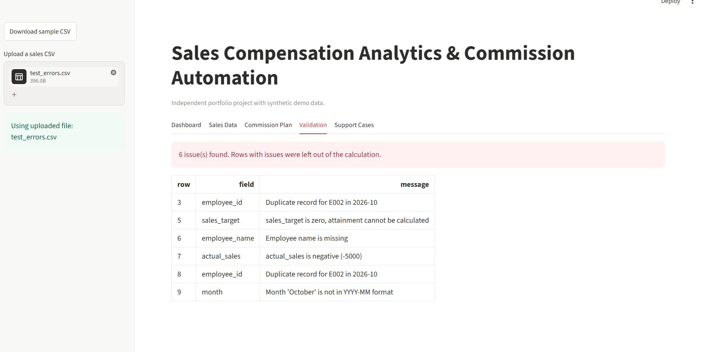
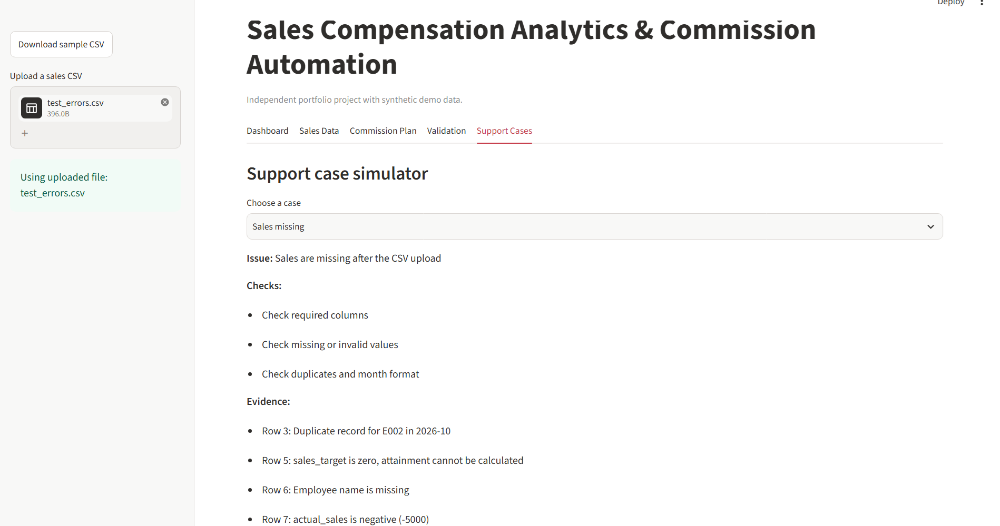

# Sales Compensation Analytics and Commission Automation Platform

A Python and Streamlit app that calculates tier-based sales commissions, validates uploaded sales data, shows performance dashboards and simulates customer-support troubleshooting.

Note: This is an independent portfolio project inspired by the sales-compensation problem space. It is not Everstage's product and does not use any proprietary commission logic. All data is synthetic.

## Business problem

Manual sales incentive calculations are error-prone, hard to audit and hard to scale. Managers need transparent calculations and reliable reporting.

## Features

- Upload a sales CSV or use the built-in sample data
- Validation with row numbers: missing columns, missing IDs or names, duplicates, negative values, zero targets, wrong month format
- Commission engine: attainment, tier selection and payout
- Configurable commission plan (change tiers and rates, payouts recalculate)
- Dashboard: KPI cards, actual vs target, payout by employee, attainment distribution, ranking
- SQLite database for employees, sales records, plans and calculation results
- Support case simulator: issue, checks, evidence, root cause, resolution, verification
- Automated tests for tier boundaries and edge cases

## Commission rules (demo)

- Below 80% attainment: 2%
- 80% to below 100%: 5%
- 100% to 120%: 8%
- Above 120%: 12%

Payout = actual sales x applicable rate. This is a simplified demo rule. Real compensation plans may differ.

## Screenshots

Dashboard:

Calculation detail:

Commission plan:

Data validation report:

Support case investigation:

## Project structure

- app.py: Streamlit app
- modules/commission_engine.py: attainment, tiers, payout
- modules/data_validation.py: CSV checks with row numbers
- modules/analytics.py: KPI calculations
- modules/database.py: SQLite storage and queries
- modules/support_simulator.py: support case investigations
- database/schema.sql: table definitions
- tests/: pytest tests
- data/: sample and test CSV files

## Setup

1. Install Python 3.10 or newer.
2. Install the packages with: pip install -r requirements.txt
3. Run the app with: python -m streamlit run app.py
4. Run the tests with: python -m pytest tests -v

## Sample data

- data/sales_data.csv: valid synthetic data (5 employees, month 2026-10)
- data/test_errors.csv: file with deliberate errors to demo validation
- data/bad_sales_data.csv: file where every row has an error

Expected result for the sample data: total payout 211,900.

## Tests

11 tests cover the tier boundaries (79, 80, 99, 100, 120, 121), attainment, zero target, negative values, missing values and payout.

## Limitations

- Simplified single-formula commission rule
- One commission plan at a time, no quotas by role or team
- Local SQLite database, no user login
- Rows with validation errors are left out of the calculation, not corrected

## Future improvements

- Multiple plans by role or department
- Accelerators, caps and split credits
- Edit and re-upload corrected rows inside the app
- Cloud deployment
